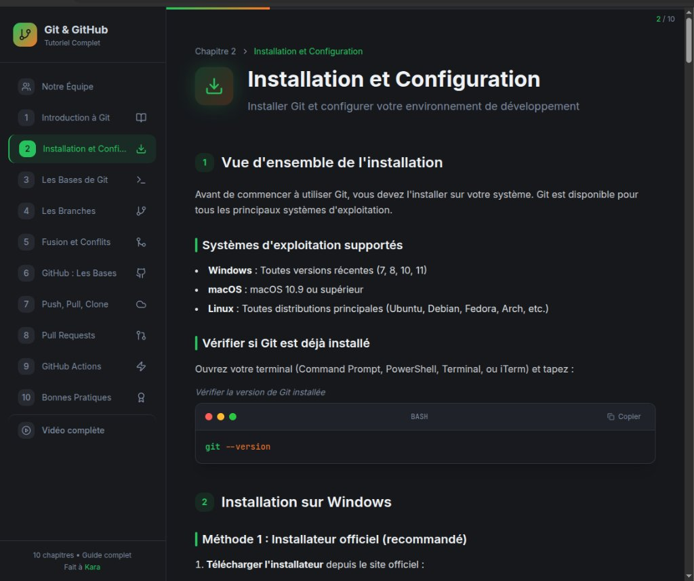
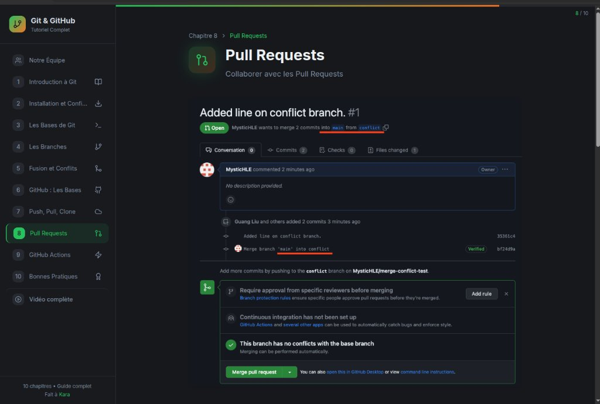

# Git & GitHub - Tutoriel Complet

Plateforme pedagogique interactive d'apprentissage pratique du systeme de controle de version Git et de la plateforme collaborative GitHub, concue dans un cadre universitaire a l'Universite de Kara.


## Contexte Academique

Ce projet a ete initie et encadre par le Docteur SAMIE, responsable pedagogique au sein de la Licence Professionnelle en Informatique a l'Universite de Kara (Togo).

Il s'inscrit dans une synergie etudiante entre deux filieres d'excellence :
- LPDM : Licence Professionnelle en Developpement Web et Mobile
- LPSIC : Licence Professionnelle en Securite Informatique et Cybersecurite

### Equipe de Conception et Developpement

- DEFALEOUNA Tchassama Dessoklema (Filiere LPDM)
- NYABO Kodjo Messan Pacome (Filiere LPSIC)
- EGBOHOU William Manguiliwe (Filiere LPSIC)
- FAYA Esso-Rong Lazare (Filiere LPSIC)
- ATHON B. Maxime (Filiere LPDM)

## Presentation du Projet

Git & GitHub - Tutoriel Complet est une application web moderne offrant un parcours d'apprentissage progressif, detaille et pragmatique, allant des bases absolues du versioning local jusqu'aux workflows avances d'integration continue et de collaboration en equipe.

L'objectif principal est de fournir aux etudiants et aux developpeurs une reference pedagogique structuree en langue francaise, accompagnee d'exemples de commandes prets a l'emploi, de bonnes pratiques industrielles et d'une section video dediee.



## Programme Pedagogique (10 Chapitres)

La formation est organisee en 10 modules progressifs :

### 1. Introduction a Git
- Principes fondamentaux du controle de version developpe par Linus Torvalds.
- Architecture distribuee vs systemes centralises (SVN, CVS).
- Fonctionnement interne : snapshots immutables, hachages SHA-1, arbre des objets.
- Les trois etats du fichier : Repertoire de travail (Working Directory), Zone d'index (Staging Area), Depot local (Repository).

### 2. Installation et Configuration
- Procedure pas-a-pas pour Windows (installateur officiel, integration Git Bash, configuration du terminal).
- Procedure pour macOS (Homebrew, Xcode Command Line Tools).
- Procedure pour distributions Linux (Debian, Ubuntu, Fedora, Arch Linux).
- Configuration de l'identite globale du developpeur (git config user.name et user.email).
- Parametrage des fins de ligne (core.autocrlf), de l'editeur par defaut et des alias essentiels.
- Verification de l'environnement avec la commande git --version.

### 3. Les Bases de Git
- Initialisation d'un nouveau projet avec git init.
- Inspection de l'etat des fichiers avec git status.
- Indexation selective et globale avec git add.
- Enregistrement des instantanes via git commit avec messages conformes aux standards.
- Visualisation et exploration de l'historique des modifications avec git log et options de formatage.

### 4. Les Branches
- Interet strategique de la ramification : isolation des fonctionnalites, experimentation sans risque.
- Creation, basculement et navigation entre branches (git branch, git checkout, git switch).
- Nettoyage et suppression securisee des branches apres livraison.

### 5. Fusion et Conflits
- Integration des modifications d'une branche dans une autre via git merge (Fast-forward vs Three-way merge).
- Analyse et resolution manuelle des marqueurs de conflits.
- Comparaison methodologique entre git merge et git rebase : cas d'usage, preservation ou linearisation de l'historique.

### 6. GitHub : Les Bases
- Creation et securisation d'un compte developpeur sur la plateforme GitHub.
- Creation d'un depot distant (public ou prive) avec README et licence.
- Generation et association d'une paire de cles SSH (Ed25519 / RSA) pour l'authentification securisee.

### 7. Push, Pull, Clone
- Duplication locale d'un projet distant avec git clone.
- Envoi et publication de ses branches locales vers le serveur distant avec git push.
- Recuperation et synchronisation des contributions d'equipe avec git pull et git fetch.
- Gestion des liaisons distantes avec git remote (ajout, renommage, suppression).

### 8. Pull Requests et Revue de Code
- Workflow de contribution collaborative et modeles de forks.
- Ouverture d'une Pull Request documentee.
- Processus de revue de code, commentaires de relecture et approbations obligatoires.
- Regles de protection des branches principales (Branch Protection Rules).
- Fusion et fermeture des Pull Requests.



### 9. GitHub Actions et CI/CD
- Concepts cles : Workflows, Jobs, Steps, Actions et Runners.
- Structure d'un fichier de configuration YAML dans .github/workflows/.
- Declencheurs d'evenements (triggers : on push, on pull_request, schedule).
- Automatisation des tests unitaires, du linting et de la compilation.
- Strategie de deploiement continu automatise.

### 10. Bonnes Pratiques et Gitflow
- Conventions de messages de commits (specification Conventional Commits : feat, fix, docs, refactor, test, chore).
- Modele de branching Gitflow : roles des branches main, develop, feature, release et hotfix.
- Configuration et syntaxe du fichier .gitignore pour exclure les fichiers sensibles, logs et dependances (node_modules, .env).
- Synthese des commandes utilitaires indispensables au quotidien du developpeur.

### Module Complementaire : Video Complete
- Section dediee integrant un tutoriel video exhaustif pour approfondir chaque notion pratique.

## Fonctionnalites Techniques de la Plateforme

- Navigation fluide et intuitive : barre laterale persistante avec acces rapide a l'ensemble des chapitres et a la page Equipe.
- Suivi de progression dynamique : indicateur de progression en temps reel affiche en haut d'ecran.
- Blocs de code interactifs : terminal integre avec coloration syntaxique Bash, nom du shell et bouton de copie en un clic.
- Mode sombre soigne : theme sombre optimise pour le confort visuel prolonge des developpeurs.
- Design responsive : affichage adapte aux ecrans de bureau, tablettes et terminaux mobiles.

## Technologies Utilisees

- React 18 : Bibliotheque JavaScript pour la creation d'interfaces reactives.
- TypeScript : Typage statique garantissant la robustesse du code.
- Vite : Outil de build moderne et serveur de developpement ultra-rapide.
- Tailwind CSS : Framework utilitaire pour une mise en page soignee et moderne.
- Radix UI : Primitives de composants accessibles et modulaires.
- Framer Motion : Animations fluides des transitions de chapitres.
- Lucide React : Iconographie vectorielle complete.
- React Router DOM 6 : Gestion du routage applicatif client.

## Installation et Lancement Local

### Prerequis

- Node.js (version 18 ou superieure recommandee)
- npm ou bun

### Etapes d'Installation

1. Cloner le depot du projet :

```bash
git clone https://github.com/maximedefaleouna/git-mastery-hub.git
cd git-mastery-hub
```

2. Installer les dependances :

```bash
npm install
```

3. Demarrer le serveur de developpement local :

```bash
npm run dev
```

L'application sera accessible sur `http://localhost:8080` (ou le port indique dans le terminal).

4. Compiler pour la production :

```bash
npm run build
```

## Auteurs et Encadrement

- Encadrement pedagogique : Docteur SAMIE (Universite de Kara)
- Concepteurs : Etudiants en Licence Professionnelle en Informatique (filières LPDM et LPSIC)
- Maintenance du depot : [@maximedefaleouna](https://github.com/maximedefaleouna)

## Licence

Ce projet est mis a disposition sous licence MIT. Libre a vous de l'utiliser, de le modifier et de l'adapter dans un cadre academique ou professionnel.
